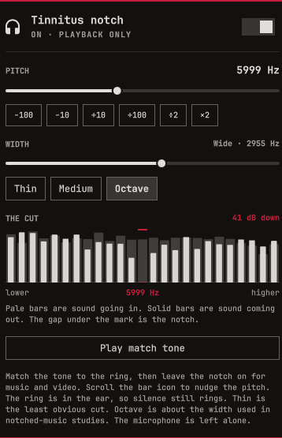

# Tinnitus notch for Omarchy

Match a ringing pitch, then cut that band out of everything the PC plays.



The chip in the bar is the pitch. Click it to tune. Right-click, or the switch in the panel, turns the notch on. Scroll nudges the pitch by 20 Hz.


This is a playback filter. It does not treat tinnitus, and silence still rings, because the ring is in the hearing pathway. The filter only changes what the speakers play. The microphone is never touched.

## Install

```bash
omarchy plugin add https://github.com/imcmurray/omarchy-tinnitus-notch.git --enable
```

That puts the chip on the bar and installs the user service. It does not turn the notch on. The service file is `~/.config/systemd/user/tinnitus-notch.service`. The bar writes it when the plugin loads, and turning the notch on writes it again if that has not finished. The file is created when it is missing, and replaced only when it already contains this plugin's marker. A different file at that path is left alone.

`bin/setup` does that same write, and nothing else. You do not need to run it to install.

Put the chip wherever you like when Omarchy asks. The default section is the right side of the bar.

## Requirements

Omarchy with PipeWire and `python3`. The helper uses the standard library plus `pactl` and `pw-cli`, which ship with PipeWire. No extra packages. No sudo.

## Devices

The notch sits in front of whichever output is selected: headphones, a USB DAC, HDMI, analog, Bluetooth, stereo, or surround. Choosing another output in the audio panel moves the notch onto that device and uses that device's channel map, so a surround receiver stays surround. A channel map it does not recognize plays as stereo through PipeWire's converter instead of going silent. The volume keys still control the real output.

Tested layouts, on private sinks: mono, stereo, 5.1, and 7.1. Each channel of a 6 kHz notch left 1 kHz in place and cut 6 kHz.

## Use

1. Play music or a video.
2. Open the panel and turn the notch on.
3. Drag **Pitch** until it matches the ring. Arrow keys nudge it. `T` plays a short match tone at that pitch. The tone is mixed in after the notch, so you can still hear it.
4. Drag **Width** if the cut is too narrow or too wide. The default is a medium band around the pitch.

**The cut** is a before/after level meter, drawn only while the panel is open and the notch is on. Pale bars are sound going into the filter. Solid bars are sound reaching the speakers. The mark in the middle is the pitch. With nothing playing, the outline is the shape of the cut, not a measurement.

Space toggles the notch. Esc closes the panel.

## Update

```bash
omarchy plugin update ianm.tinnitus
```

The next time the bar loads, it refreshes the service file when this plugin owns it. Toggle the notch off and on once so the running filter picks up the new helper.

## Remove

```bash
~/.config/omarchy/plugins/ianm.tinnitus/bin/setup --remove
omarchy plugin remove ianm.tinnitus
```

`--remove` turns the notch off and deletes the user service. Your last pitch stays in `~/.config/tinnitus-notch/state.json`. Delete that directory if you do not want it.

## What the research actually did

Tailor-made notched music training removes a band around a person's tinnitus pitch from music they choose, then has them listen for a long time. It is not the same thing as notching every sound a computer plays. The trials below are the ones this filter is patterned after. Results are mixed, and none of them tested a system-wide playback notch.

- Okamoto, Stracke, Stoll, and Pantev. [Listening to tailor-made notched music reduces tinnitus loudness and tinnitus-related auditory cortex activity.](https://doi.org/10.1073/pnas.0911268107) *PNAS*, 2010. Eight people listened to music notched at their tinnitus pitch for about 12 months. Eight others got the same listening schedule with the notch placed somewhere else. The matched notch group reported lower tinnitus loudness, and auditory cortex activity at that pitch dropped. [Full text](https://pmc.ncbi.nlm.nih.gov/articles/PMC2824261/).
- Teismann, Okamoto, and Pantev. [Short and intense tailor-made notched music training against tinnitus: the tinnitus frequency matters.](https://doi.org/10.1371/journal.pone.0024685) *PLOS ONE*, 2011. Five days at about six hours a day. Loudness and distress fell for the ten people whose tinnitus was at or below 8 kHz, and not for the ten above that. The loudness change had faded within a few days of stopping.
- Stein, Wunderlich, Lau, Engell, Wollbrink, Shaykevich, Kuhn, Holling, Rudack, and Pantev. [Clinical trial on tonal tinnitus with tailor-made notched music training.](https://doi.org/10.1186/s12883-016-0558-7) *BMC Neurology*, 2016. One hundred people listened two hours a day for three months. The distress questionnaire (the primary outcome) did not improve. A loudness rating was lower in the treatment group at follow-up.

A plain-language summary of the notched-sound evidence, including studies that did not find a benefit, is at the [Tinnitus Treatment Evidence Review](https://tinnitusevidence.com/treatments/notched-sound/).

## Permissions

Runs as unsandboxed user code inside `omarchy-shell`, plus a user service that starts a PipeWire filter-chain sink. While the notch is on, that sink is the default output and playback streams are moved onto it. The service stops when you turn the notch off, and streams go back to the previous output. Enabling the plugin writes only `~/.config/systemd/user/tinnitus-notch.service`, and only when that file is missing or already marked as this plugin's unit. Nothing starts the service except turning the notch on. `bin/setup --remove` is the command that stops it and deletes that unit. The level meter listens only to playback monitors and refuses to keep a recorder that is not on a `.monitor` source.

## License

MIT.
